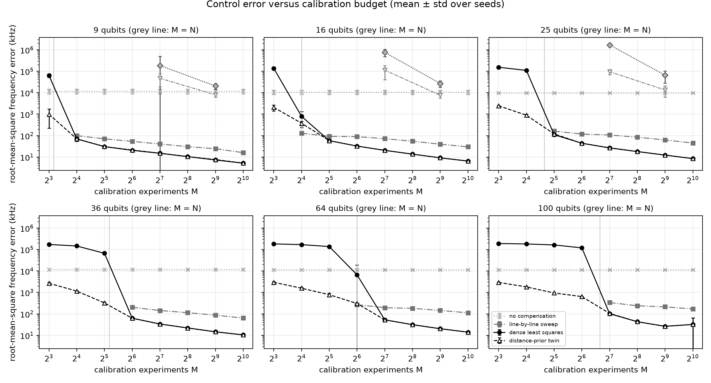
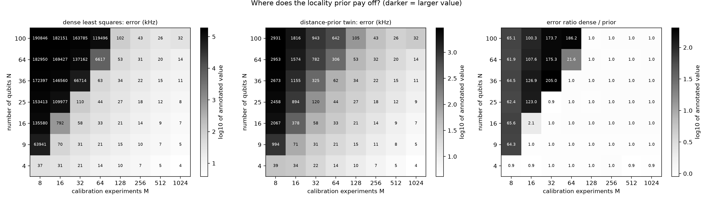
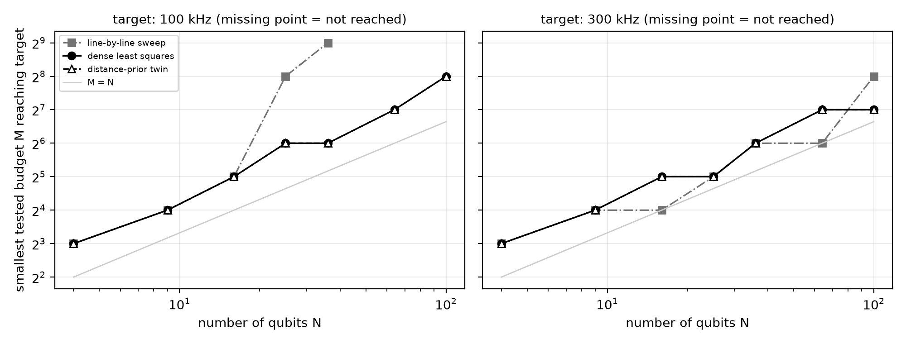
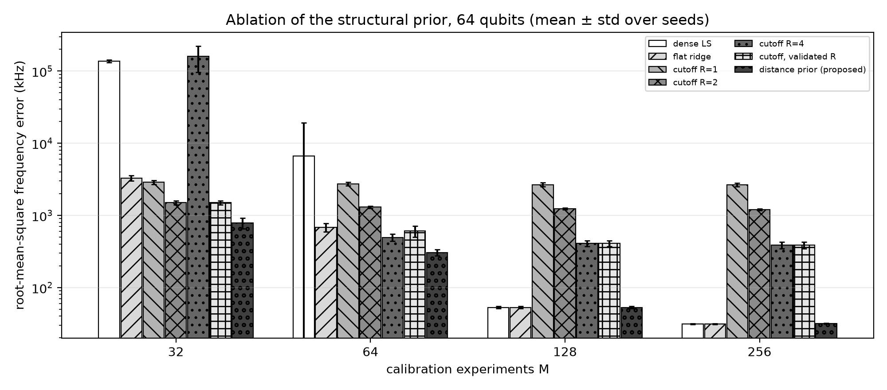
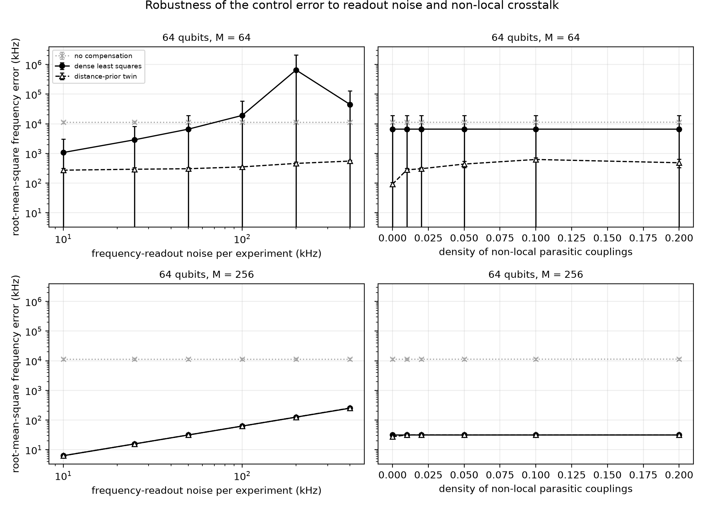
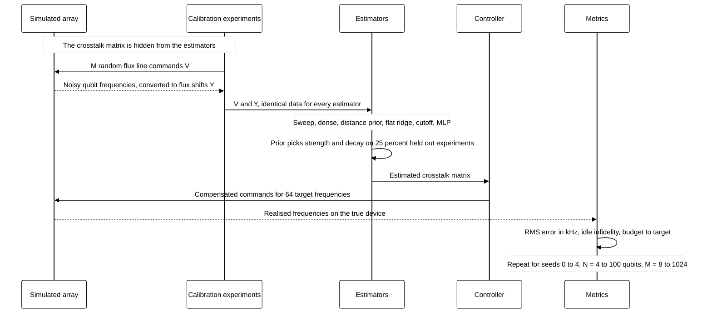

# Locality-Prior Digital Twin of Flux-Line Crosstalk: Calibration Budget versus Array Size

[](LICENSE)
[](pyproject.toml)
[](https://github.com/pradeepdegalaroyal/locality-prior-flux-crosstalk-digital-twin/actions/workflows/ci.yml)

**Research question.** When a flux-tunable qubit array grows from 4 to 100 qubits, how many calibration experiments does a digital twin of the control-line crosstalk need before crosstalk-compensated frequency control reaches 100 kHz root-mean-square (RMS) error, and does a locality-structured prior reduce that number?

**One-line answer (simulation).** The prior does not lower the budget needed to reach 100 kHz (it and unstructured least squares both need M = 128 experiments at N = 64 and M = 256 at N = 100, that is 2 to 2.6 times N, on the tested grid), but it removes the failure of least squares when the number of experiments M is at or below the number of qubits N, cutting the error at N = 64, M = 32 from 137,162 kHz to 782 kHz; a generic neural twin was far worse than either.

## Abstract

We simulate frequency control of square-lattice arrays of 4-100 flux-tunable transmon qubits whose control lines leak into neighbouring qubits through an unknown crosstalk matrix, and treat the number of parallel calibration experiments M as the scarce resource. A distance-weighted Bayesian (ridge) prior on the crosstalk matrix is compared with the line-by-line sweep, dense least squares, a distance-blind ridge, hard-cutoff banded fits and two multilayer-perceptron (MLP) twins, on identical data and five seeds. The prior matches dense least squares when M >= 2N and avoids its blow-up for M <= N (error at N = 100, M = 64: 642 kHz versus 119,496 kHz), but at M = N the orthogonal line sweep is as good or better, and the hypothesis that the prior lowers the budget needed for a given accuracy is not supported.

## What is new here

* A budget-versus-size study that treats the number of **calibration experiments** as the cost axis for a digital twin of a control layer (the supplied literature discusses scale and noise but not this cost).
* A like-for-like comparison, on shared experiments, of a distance-prior twin, the line-sweep standard, dense least squares and two generic neural twins, with a distance-blind ridge and hard-cutoff ablations that isolate *why* the prior helps.
* Pre-stated hypotheses (`docs/RESEARCH_GAP.md`) of which one is **falsified** and two are supported only in a restricted regime; negative results are reported as such.

## Motivation

Hardware with tens of qubits and tunable couplers already exists, and its authors stress that scaling needs high-precision control (Wu et al., 2021, Digital Object Identifier (DOI) 10.1103/PhysRevLett.127.180501). Algorithms such as quantum signal processing (QSP) are built from long sequences of precise single-qubit rotations (Low and Chuang, 2017, DOI 10.1103/PhysRevLett.118.010501), and the newest survey of quantum machine learning (QML) lists trainability and automated design in the Noisy Intermediate-Scale Quantum (NISQ) regime as unresolved (Pereira et al., 2027, DOI 10.1007/978-3-032-27834-0_47). A digital twin of the control layer, which predicts what each qubit does when every control line is driven at once, is a prerequisite for that kind of automation, and it must be built from experiments that cost machine time. How that cost depends on array size is what is measured here.

## Research gap

Only eight papers were supplied (one recent, three landmark, four review). None models the control layer, so the gap is derived rather than quoted: the landmark hardware paper requires high-precision control at scale, the algorithmic landmark depends on precise single-qubit rotations, and the review of fault-tolerant resource estimates (Blunt et al., 2022, DOI 10.1021/acs.jctc.2c00574) assumes an error-corrected architecture that does not yet exist. The related-work table of eight papers and the derivation are in [`docs/RESEARCH_GAP.md`](docs/RESEARCH_GAP.md).

## Hypotheses (fixed before the final run)

* **H1.** At fixed M <= N, the distance-prior twin has lower RMS error than dense least squares, and the ratio grows with N.
* **H2.** The smallest budget M* reaching 300 kHz and 100 kHz is smaller for the prior than for dense least squares and the sweep.
* **H3.** The advantage disappears for M much larger than N and for dense non-local couplings.
* **H4.** A generic MLP twin does not close the gap.

## Results

Metric: RMS difference (kHz) between realised and target qubit frequencies over 64 random targets (up to about 200 MHz away from the bias point), mean ± standard deviation over seeds 0-4. N = number of qubits, M = number of calibration experiments (each drives all lines and reads all qubits in parallel), readout noise 50 kHz, parasitic coupling density 0.02. "Dense LS" is dense least squares. All numbers are copied from `results/`.

### Scaling with array size and budget

| N | M | no compensation | line sweep | dense LS | flat ridge | cutoff (validated) | **distance prior** |
|---|---|---|---|---|---|---|---|
| 16 | 16 | 10,656 ± 2,581 | 130 ± 10 | 792 ± 552 | 801 ± 170 | 1,480 ± 233 | 378 ± 84 |
| 25 | 16 | 9,834 ± 406 | not defined (M < N) | 109,977 ± 6,054 | 2,497 ± 390 | 1,876 ± 160 | 894 ± 96 |
| 36 | 32 | 11,655 ± 1,236 | not defined (M < N) | 66,714 ± 5,720 | 1,547 ± 89 | 1,305 ± 121 | 325 ± 40 |
| 64 | 32 | 11,262 ± 999 | not defined (M < N) | 137,162 ± 6,171 | 3,286 ± 272 | 1,500 ± 94 | 782 ± 133 |
| 64 | 64 | 11,262 ± 999 | 270 ± 7 | 6,617 ± 12,672 | 684 ± 96 | 607 ± 106 | 306 ± 29 |
| 64 | 128 | 11,262 ± 999 | 194 ± 2 | 53 ± 2 | 53 ± 2 | 410 ± 39 | 53 ± 2 |
| 100 | 64 | 11,293 ± 730 | not defined (M < N) | 119,496 ± 3,558 | 2,941 ± 197 | 802 ± 36 | 642 ± 19 |
| 100 | 128 | 11,293 ± 730 | 338 ± 5 | 102 ± 3 | 102 ± 3 | 584 ± 15 | 105 ± 12 |
| 100 | 1024 | 11,293 ± 730 | 170 ± 2 | 32 ± 33 | 32 ± 33 | 508 ± 17 | 32 ± 33 |

The line sweep needs M >= N (one experiment per line), hence "not defined" below that.



*Figure 1. Dense least squares has a cliff at M of about N, the prior degrades gracefully below it and coincides with dense least squares above 2N; the line sweep is better at M = N but plateaus above it.*



*Figure 2. The prior's advantage (dense-to-prior ratio up to 205) is confined to the lower-budget triangle M below about N; elsewhere the ratio is 1.0.*

### Budget needed to reach a target accuracy

Smallest tested M (grid of powers of two, so the resolution is a factor of 2) whose seed-mean error is below the target (`results/budget_to_target.csv`):

| target | N | sweep | dense LS | distance prior |
|---|---|---|---|---|
| 100 kHz | 4 | 8 | 8 | 8 |
| 100 kHz | 9 | 16 | 16 | 16 |
| 100 kHz | 16 | 32 | 32 | 32 |
| 100 kHz | 25 | 256 | 64 | 64 |
| 100 kHz | 36 | 512 | 64 | 64 |
| 100 kHz | 64 | not reached | 128 | 128 |
| 100 kHz | 100 | not reached | 256 | 256 |
| 300 kHz | 4 | 8 | 8 | 8 |
| 300 kHz | 9 | 16 | 16 | 16 |
| 300 kHz | 16 | 16 | 32 | 32 |
| 300 kHz | 25 | 32 | 32 | 32 |
| 300 kHz | 36 | 64 | 64 | 64 |
| 300 kHz | 64 | 64 | 128 | 128 |
| 300 kHz | 100 | 256 | 128 | 128 |



*Figure 3. The budget to reach a target is the same for the prior and dense least squares, and is 2 to 2.6 times N at 100 kHz for N = 64 and 100; the sweep needs more or never reaches 100 kHz.*

### Ablation of the structural prior (N = 64)

R = cutoff radius in lattice constants.

| M | dense LS | flat ridge | cutoff R=1 | cutoff R=2 | cutoff R=4 | cutoff, validated R | distance prior |
|---|---|---|---|---|---|---|---|
| 32 | 137,162 ± 6,171 | 3,286 ± 272 | 2,870 ± 190 | 1,500 ± 94 | 159,520 ± 62,610 | 1,500 ± 94 | 782 ± 133 |
| 64 | 6,617 ± 12,672 | 684 ± 96 | 2,725 ± 159 | 1,299 ± 50 | 495 ± 57 | 607 ± 106 | 306 ± 29 |
| 128 | 53 ± 2 | 53 ± 2 | 2,672 ± 156 | 1,229 ± 36 | 410 ± 39 | 410 ± 39 | 53 ± 2 |
| 256 | 31 ± 0 | 31 ± 0 | 2,651 ± 154 | 1,196 ± 35 | 388 ± 40 | 388 ± 40 | 32 ± 0 |



*Figure 4. The distance profile matters: below M = N the distance-blind ridge is 2-4 times worse, and every hard cutoff has a bias floor (R = 1, 2, 4) or an ill-conditioned fit (R = 4 at M = 32).*

### Robustness to readout noise and non-local crosstalk (N = 64)

| sweep (N = 64) | value | M | dense LS | distance prior |
|---|---|---|---|---|
| readout noise (kHz) | 10 | 64 | 1,078.5 ± 1,985.5 | 273.0 ± 46.9 |
| readout noise (kHz) | 50 | 64 | 6,616.7 ± 12,671.8 | 305.8 ± 29.0 |
| readout noise (kHz) | 400 | 64 | 45,211.7 ± 84,695.1 | 553.9 ± 43.7 |
| readout noise (kHz) | 10 | 256 | 6.3 ± 0.1 | 6.3 ± 0.1 |
| readout noise (kHz) | 50 | 256 | 31.4 ± 0.4 | 31.5 ± 0.4 |
| readout noise (kHz) | 400 | 256 | 251.1 ± 3.4 | 254.2 ± 20.3 |
| parasitic density | 0 | 64 | 6,615.5 ± 12,668.2 | 92.8 ± 12.2 |
| parasitic density | 0.02 | 64 | 6,616.7 ± 12,671.8 | 305.8 ± 29.0 |
| parasitic density | 0.2 | 64 | 6,599.1 ± 12,632.7 | 486.2 ± 154.3 |
| parasitic density | 0 | 256 | 31.4 ± 0.4 | 27.3 ± 0.7 |
| parasitic density | 0.02 | 256 | 31.4 ± 0.4 | 31.5 ± 0.4 |
| parasitic density | 0.2 | 256 | 31.4 ± 0.4 | 31.4 ± 0.4 |



*Figure 5. At M = 64 the prior stays below 0.7 MHz for all noise levels and parasitic densities tested while dense least squares is unstable (standard deviation larger than the mean); at M = 256 the two are indistinguishable.*

### Generic neural twins (negative result)

Fixed-architecture, untuned multilayer perceptrons (two tanh layers of 64 units), same data, inverted by L-BFGS (limited-memory Broyden-Fletcher-Goldfarb-Shanno):

| N | M | MLP twin | MLP twin + linear skip | dense LS | no compensation |
|---|---|---|---|---|---|
| 4 | 128 | 58,611 ± 96,767 | 14,254 ± 10,120 | 10 ± 2 | 9,846 ± 2,560 |
| 4 | 512 | 16,295 ± 25,927 | 6,301 ± 4,567 | 5 ± 1 | 9,846 ± 2,560 |
| 9 | 128 | 185,322 ± 311,678 | 47,107 ± 28,275 | 15 ± 1 | 11,685 ± 3,129 |
| 9 | 512 | 20,562 ± 6,220 | 7,993 ± 1,844 | 7 ± 1 | 11,685 ± 3,129 |
| 16 | 128 | 761,780 ± 282,337 | 112,993 ± 72,692 | 21 ± 1 | 10,656 ± 2,581 |
| 16 | 512 | 26,826 ± 8,760 | 7,595 ± 1,947 | 9 ± 0 | 10,656 ± 2,581 |
| 25 | 128 | 1,689,001 ± 298,740 | 94,695 ± 25,226 | 27 ± 1 | 9,834 ± 406 |
| 25 | 512 | 65,314 ± 37,570 | 13,485 ± 7,303 | 12 ± 1 | 9,834 ± 406 |

Every neural twin is worse than not compensating at M = 128, and the linear-skip variant is only slightly better than no compensation at M = 512 (hypothesis H4 supported). The crosstalk is about 1 % of the signal, so a generic fit needs a relative precision of about 0.1 %, which these networks do not reach from 128-512 noisy samples. This reflects these untuned networks, not neural twins in general.

### Consequence for the qubits

Mean single-qubit infidelity of an equatorial state idling for 50 ns at the realised frequencies, N = 64 (`results/idle_infidelity_summary.csv`):

| M | no compensation | line sweep | dense LS | distance prior |
|---|---|---|---|---|
| 64 | 4.24e-01 ± 8.8e-03 | 1.79e-03 ± 9.9e-05 | 1.02e-01 ± 1.8e-01 | 2.30e-03 ± 4.1e-04 |
| 128 | 4.24e-01 ± 8.8e-03 | 9.29e-04 ± 1.7e-05 | 6.92e-05 ± 5.0e-06 | 6.91e-05 ± 4.9e-06 |
| 256 | 4.24e-01 ± 8.8e-03 | 8.15e-04 ± 4.5e-05 | 2.43e-05 ± 6.7e-07 | 2.45e-05 ± 6.2e-07 |

The closed-form register fidelity used for this conversion agrees with a Qiskit statevector simulation (0.9998878846 versus 0.9998878846, `results/statevector_check.json`).

## Discussion

* **H1 is supported only for M below about N**, where every estimator is poor in absolute terms: the prior reaches 0.3-3 MHz there (about 4-36 times better than no compensation, but far above 100 kHz). At N = 64 and M = 64 the line sweep (270 kHz) is as good as the prior (306 kHz) or slightly better; at N = 16, M = 16 the sweep (130 ± 10 kHz) is clearly better than the prior (378 ± 84 kHz). The sweep's orthogonal design avoids the ill-conditioning that random excitations have at M near N, so part of the failure of dense least squares is an experimental-design effect rather than a missing prior.
* **H2 is falsified on this grid**: the prior and dense least squares reach 100 kHz at the same budget for every N (for example M = 128 at N = 64 and M = 256 at N = 100), because the validated prior relaxes towards the unstructured solution once data are sufficient. The grid is coarse (factor 2), so smaller differences cannot be resolved.
* **H3 is supported**: at M >= 2N the prior equals dense least squares within seed noise, and non-local couplings raise the prior's error at M = 64 from 92.8 to 486.2 kHz (density 0 to 0.2), still far below dense least squares (6,599 kHz).
* **H4 is supported** (see above), with the caveat that the networks were not tuned.
* Hard-cutoff fits are a poor design here: the neglected tail of the crosstalk (2.6 % of the matrix norm outside radius 2, N = 100) leaves floors between 372 kHz (validated radius, M = 1024, N = 64) and 2,672 kHz (R = 1, M = 128, N = 64).
* Both estimators are noise limited above M = 2N: at M = 256 the error is proportional to readout noise (6.3 kHz at 10 kHz noise, 251.1 kHz at 400 kHz noise for dense least squares).
* At M = N the dense error for N = 64 has a standard deviation (12,672 kHz) larger than its mean (6,617 kHz): one seed has a nearly singular random design, a heavy-tailed event rather than a Gaussian spread.

## Method



RMS = root-mean-square; MLP = multilayer perceptron; kHz = kilohertz. The diagram shows one experiment run.

**Device model.** `N = side^2` transmons on a square lattice, frequency `f(phi) = fmax * sqrt(cos(pi * phi))` (fmax about 6 GHz), flux `phi = phi0 + C v`. The crosstalk matrix `C` has a unit diagonal, a local part `0.01 * exp(-(d - 1) / 0.8)` with 30 % scatter (d = lattice distance) and non-local parasitic entries (probability 0.02, amplitude about 0.002). These values are assumed, not fitted to hardware. The condition number of `C` is 1.15-1.31 across sizes.

**Experiments.** Random commands (standard deviation 0.03 flux quanta) drive all lines at once; all qubit frequencies are read in parallel with Gaussian noise (default 50 kHz) and converted to flux shifts using the known single-qubit curve.

**Estimators** (same data for all). Line sweep (standard practice); dense least squares (strongest unstructured baseline); **distance-prior twin**: ridge regression whose penalty on entry (i, j) grows as `exp(2 (d_ij - 1) / lam)`, with strength and decay length chosen on 25 % held-out experiments; flat ridge and hard-cutoff variants as ablations; two MLP twins. Details: [`docs/METHOD.md`](docs/METHOD.md).

**Control test.** Commands `C_hat^+ dphi` are applied to the true device for 64 random targets; the RMS frequency error (kHz) is the primary metric.

## Limitations

* Everything is simulated; crosstalk amplitude, decay length, noise model and lattice geometry are assumptions, and a real array may have a different (and non-square) structure.
* The model is static: no drift, no two-level-system defects, no frequency-dependent crosstalk, known single-qubit curves, Gaussian readout noise independent between qubits.
* Five seeds per cell; the heavy-tailed dense estimate at M = N means mean ± standard deviation is a poor summary there.
* The budget grid is in powers of two, so M* has a factor-2 resolution; the 100 kHz and 300 kHz thresholds were fixed before the final run, after a pilot on separate seeds.
* Generic neural twins use fixed, untuned settings; a physics-informed or tuned network might do far better.
* No claim of quantum advantage is made or implied; the quantum content is the phase error of idling qubits.

## Future work

* Replace Gaussian readout noise by simulated Ramsey sequences at finite shots (Qiskit or master-equation level) and the known single-qubit curve by a jointly fitted one.
* Combine an orthogonal or low-discrepancy excitation design with the distance prior, which should keep the sweep's advantage at M = N and the prior's graceful degradation below it.
* Track slow drift of the crosstalk matrix with the same prior inside a sequential (Kalman-type) filter, and extend to graph distances on heavy-hexagon and coupler-mediated layouts.
* On hardware, the experiment is a parallel Ramsey measurement of all qubits under random multi-line flux pulses; the prior can be initialised from design-level electromagnetic simulation of the chip package.

## Reproducibility

```bash
pip install -r requirements.txt
pip install -e . --no-deps
pytest -q                                  # 9 fast tests
python experiments/run_all.py --quick      # smoke run, under 1 minute, writes results/quick
python experiments/run_all.py              # full study, writes results/ and figures/
```

Full run: 674 s on a Windows 11 laptop (16 central processing unit (CPU) threads, 6 used by PyTorch; the graphics processor is not used). Python 3.11.9, NumPy 2.2.6, PyTorch 2.11, Qiskit 2.4.2. Seeds 0-4 are fixed; pilot tuning used seeds 1000-1002 only.

## Project structure

```
src/fluxtwin/        device.py (array and crosstalk model), estimators.py, control.py,
                     experiments.py (drivers), plotting.py
experiments/run_all.py   one command for every result and figure
tests/               nine fast tests (recovery, limits, statevector check, determinism)
docs/                RESEARCH_GAP.md, METHOD.md
results/             raw runs and summaries (tables), runtime, statevector check
figures/             five figures at 200 dpi
.github/workflows/   continuous-integration workflow (tests plus smoke run)
```

## Related work by the author

* [`low-rank-drift-twin-sentinel-recalibration`](https://github.com/pradeepdegalaroyal/low-rank-drift-twin-sentinel-recalibration): a low-rank digital twin of *time-varying* qubit-frequency drift; this project instead studies the *static* crosstalk matrix and its calibration cost.
* [`physics-fitted-vs-gan-charge-stability-sim2real`](https://github.com/pradeepdegalaroyal/physics-fitted-vs-gan-charge-stability-sim2real): physics-structured models versus generic learned translators with few measurements, the same structure-versus-generic theme in a quantum-dot setting.

## Citation

```bibtex
@software{degala_fluxtwin_2026,
  author  = {Degala, Chenchupradeep},
  title   = {Locality-Prior Digital Twin of Flux-Line Crosstalk: Calibration Budget versus Array Size},
  year    = {2026},
  version = {0.1.0},
  url     = {https://github.com/pradeepdegalaroyal/locality-prior-flux-crosstalk-digital-twin},
  license = {MIT}
}
```

MIT license (`LICENSE`). Machine-readable citation metadata: `CITATION.cff`.
